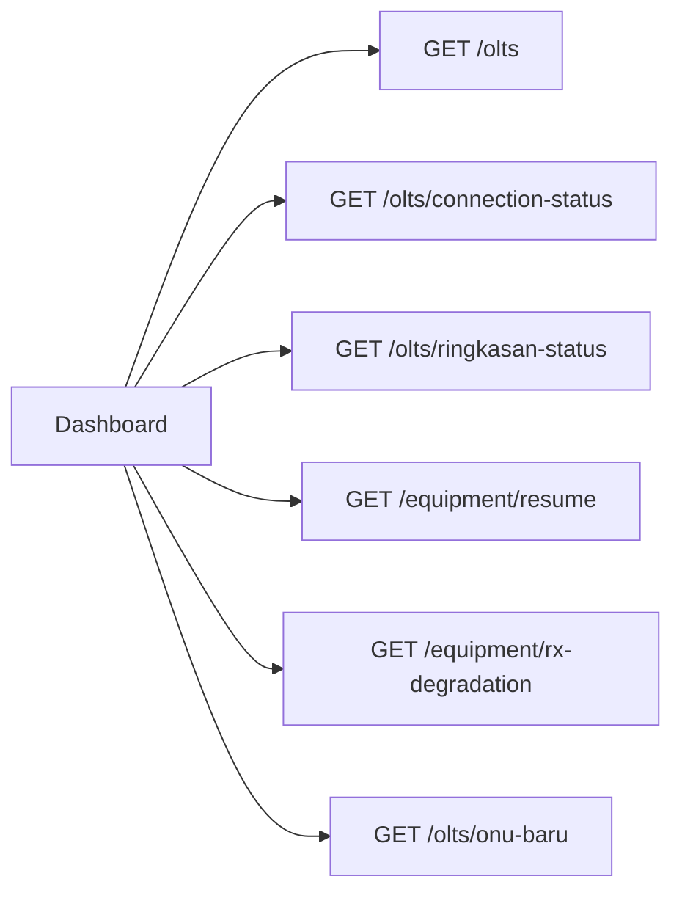
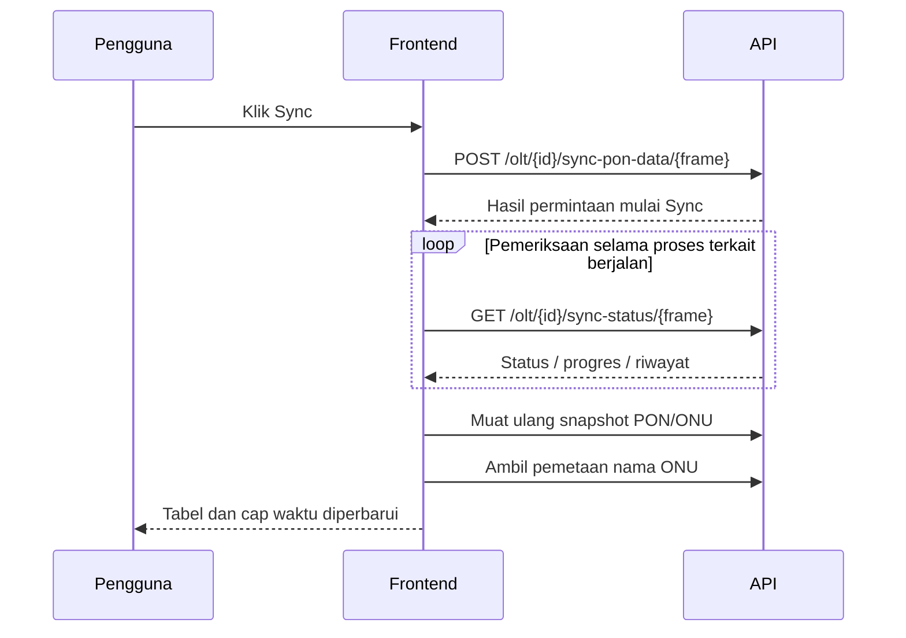

# Pemetaan alur API dan backend Zetset

Pemetaan ini melanjutkan [referensi UI](ZETSET-REFERENCE.md). Bukti berasal dari request yang dibuat situs saat halaman dibuka melalui sesi milik pengguna, struktur respons JSON, serta kode frontend JavaScript yang dikirim situs ke browser.

Ada **36 pasangan method/path API berbeda** dalam rekaman peninjauan, setelah ID dan parameter posisi dinormalisasi. Angka tersebut mencakup request akun/langganan yang hanya dicatat metadatanya; bukan seluruh endpoint produk.

## Batas bukti

| Tingkat bukti | Yang dapat disimpulkan |
| --- | --- |
| Teramati pada jaringan | Method, endpoint, nama query parameter, HTTP status, bentuk respons, serta urutan pembacaan halaman yang dibuka. |
| Terlihat pada kode frontend | Endpoint untuk memulai Sync, pemeriksaan progres, dan cara penggabungan nama ONU. Fungsi Sync tidak dijalankan dalam peninjauan. |
| Belum dapat dipastikan | Bahasa/framework API, tabel dan transaksi database, teknologi cache, worker/queue, SNMP OID, perintah CLI internal, algoritme parser, serta mekanisme enkripsi/isolasi tenant di server Zetset. |

Halaman frontend memakai `https://baru.zetset.id`, sedangkan request data utama menuju `https://api.zetset.id`. Asset `/_next/static/` dan kode frontend menunjukkan penggunaan Next.js. Hal ini tidak menentukan teknologi server API.

Tidak ada header autentikasi, cookie, nilai token, password, community, atau nilai data pelanggan dalam rekaman kontrak. Bentuk JSON hanya menyimpan nama field dan tipe; field rahasia diberi penanda `redacted`. ID URL dinormalisasi.

## Dashboard: beberapa pembacaan terpisah



| Endpoint | Bentuk data yang teramati |
| --- | --- |
| `GET /olts` | `olts[]`, `count`, identitas/koneksi/model OLT. |
| `GET /olts/connection-status` | `statuses[]`: `olt_id`, `status`, `model_type`, `checked_at`, `last_sync_at`. |
| `GET /olts/ringkasan-status` | Rekap `total`, `online`, `offline`, `los`, `dying_gasp`, `bermasalah`, `diperbarui_pada` dan PON paling bermasalah per OLT. |
| `GET /equipment/resume` | Rekap ONU, pelanggan, OTB, ODC, ODP serta pemakaian port. |
| `GET /equipment/rx-degradation` | `items[]`, `correlated[]`, `summary`, `metadata`: baseline, RX kini, delta, tingkat gangguan, jendela pengamatan, waktu kalkulasi dan indikasi data lama. |
| `GET /olts/onu-baru` | Jumlah ONU baru per OLT, keadaan pembacaan, umur data, status penyegaran, dan jeda. |

Kontrak tersebut memisahkan inventaris, status koneksi, rekap ONU dan analisis optik. Jumlahnya tidak harus mempunyai cap waktu yang sama. Teknologi penyimpanan dan jadwal kalkulasi internal tidak terlihat.

## Daftar ONU dan penggabungan nama

Saat membuka OLT, browser mengambil beberapa bagian data:

| Endpoint | Peran yang terlihat |
| --- | --- |
| `GET /olt/{id}/all-pon/{frame}?kolom=...` | Snapshot slot/PON/ONU beserta `last_sync`, `sync_id`, `never_synced`, `sync_in_progress`, informasi dukungan kolom dan ambang sinyal. |
| `GET /olt/{id}/onu-names?frame=...` | `names[]` berisi `name`, `slot`, `pon`, `onu`. |
| `GET /olt/{id}/sync-status/{frame}` | Statistik dan riwayat proses sinkronisasi. |
| `GET /olt/{id}/capabilities` | Fitur dan aksi yang didukung profil OLT, termasuk perbedaan GPON/EPON dan batas aksi. |
| `GET /onu/tags/by-olt/{id}` | Pemetaan tag untuk OLT terpilih. |
| `GET /olt/{id}/sinyal-ringkas` | Ambang ONT/OLT, jumlah pembacaan, peringatan, kritis dan data tidak terbaca. |
| `GET /olt/{id}/check-pons/{frame}` | Slot, tipe kartu, port aktif dan metadata pemetaan interface. |
| `GET /olt/{id}/unconfigured-onts?lite=...` | ONU belum terdaftar, identitas vendor/model, PON yang tersedia, ID ONU terpakai/tersedia dan penanda cache. |

Pada fungsi frontend `useNamaONUPerPosisi`, daftar nama dimasukkan ke map dengan kunci **slot–PON–ONU**. Scope OLT berasal dari request dan query key; frame dikirim sebagai parameter request. Artinya, pemetaan nama yang terlihat pada klien tidak hanya mengandalkan serial.

Ini relevan untuk NMS lokal yang mengizinkan SN duplikat: pertahankan identitas per OLT/port/index dan jangan saling menimpa nama berdasarkan SN saja. Contoh yang sudah diverifikasi adalah **SIDSMP-PAS1-BDG**, posisi **1/10:31**, serial **ZTEGCCA26B50**. Perintah/OID yang mengisi endpoint nama Zetset belum diketahui; gunakan parser CLI NMS kita sendiri.

Daftar lintas OLT memakai `GET /onu/daftar-status` dengan parameter `status`, `urut`, `limit`, `offset`, `kolom` dan kadang `ringkas`. Respons memisahkan `onus[]`, `ringkasan`, `per_olt`, `total`, serta metadata kolom. Item ONU membedakan `name`, `olt_name`, `serial_number`, posisi, phase/status, `admin_status`, metrik dan sumber status/terakhir online. Pencarian `SIDSMP` pada halaman per OLT tidak menghasilkan endpoint pencarian baru pada rekaman ini; perilaku pencarian lain tidak disimpulkan.

## Sync: alur yang disediakan frontend

Kode frontend yang diperiksa memperlihatkan:

1. Memulai proses lewat `POST /olt/{id}/sync-pon-data/{frame}` dengan body JSON kosong.
2. Membaca `GET /olt/{id}/sync-status/{frame}`. Hook dashboard memakai interval 3 detik selama kondisi pekerjaan terkait masih memerlukan polling.
3. Komponen detail mendukung `sync_in_progress`, `current_sync.id`, `started_at`, `progress_percentage`, `current_step` dan `sync_history`.
4. Status selesai memicu invalidasi/pemuatan ulang query PON; nama ONU tersedia lewat query terpisah.



Diagram ini menjelaskan kontrak yang disediakan kode klien. Tombol Sync tidak ditekan, sehingga respons aktual dari permintaan mulai Sync dan pelaksanaan job di server tidak diuji. Desain klien mendukung proses asinkron; jenis worker/queue dan urutan polling perangkat belum dapat dipastikan.

## Detail perangkat: data tersimpan lalu penyegaran

Request berikut benar-benar teramati:

- `POST /olt/{id}/info?sumber=tersimpan`, body `{}`: model/uptime dan identitas shelf/kartu.
- `GET /olt/{id}/cards?sumber=tersimpan`: kartu, CPU, memori, suhu, daya dan metrik shelf.
- `GET /olt/{id}/onu-detail/{frame}/{slot}/{pon}/{onu}?sumber=tersimpan`: nama, serial, status administratif, status fase, model/deskripsi dan hubungan ODP.
- `GET /olt/{id}/port-manager/{frame}?sumber=tersimpan`, kemudian request endpoint yang sama dengan `sumber=live` setelah halaman melakukan penyegaran otomatis.

Beberapa respons menyertakan objek berikut. Contoh di bawah menunjukkan **tipe field**, bukan nilai aktual:

```json
{
  "sumber_data": {
    "jenis": "string",
    "ada": "boolean",
    "diamati_pada": "string",
    "umur_detik": "number",
    "durasi_ms": "number atau null",
    "parsial": "boolean",
    "basi": "boolean",
    "menyegarkan": "boolean",
    "jeda_detik": "number"
  }
}
```

Kontrak ini menjelaskan label tersimpan/live dan penyegaran pada UI. Adanya data tersimpan tidak membuktikan Redis atau basis data tertentu. `POST` pada endpoint info merupakan pembacaan pada alur UI; penilaian operasi tidak semata berdasarkan nama method HTTP.

## Staff, audit dan FTTH

| Modul | Kontrak yang terlihat |
| --- | --- |
| Staff | `GET /staff?page=...&limit=...`: pagination, ringkasan aktif/nonaktif/level, `accessible_modules`, dan permission per modul. Nama level Zetset berbeda dari PRD lokal; tidak mengganti role lokal. |
| Audit | `GET /permissions/audit-logs` dan `/permissions/audit-logs/stats`: pagination/filter, modul, aksi, status berhasil/gagal, objek, konteks pengguna, serta statistik. |
| Tags | `GET /onu/tags`: daftar tag; peninjauan tidak membuat tag atau mengubah relasinya. |
| FTTH | `GET /network/topology-by-olt/{id}`: OLT, pelanggan, OTB/ODC/ODP/tiang, koneksi dan rekap. Data topologi dibaca sebagai satu respons untuk OLT terpilih. |
| Trap | Dashboard dan halaman OLT membaca `/trap/overview`, `/olt/{id}/trap/summary` dan `/olt/{id}/trap/onu-status`. Field respons memuat penanda beta/partisipasi; transport penerima serta pengolahan event internal belum diketahui. |

## Implikasi bagi backend NMS lokal

Kode lokal saat ini dapat diperiksa langsung: `routes/web.php`, `RealOltOperations`, dan `ZteTelnetDriver`. Berbeda dari temuan Zetset yang berasal dari antarmuka API, alur lokal berikut diketahui dari implementasinya:

`POST /olts/{id}/sync` → autentikasi/izin/tenant → lock per OLT → login Telnet/SSH → sistem/kartu → state dan SN per port → checkpoint inventaris → pengambilan nama → checkpoint nama → optik ONU working → transaksi akhir/log optik → respons dashboard.

Pengembangan yang masuk akal dari referensi, belum diterapkan oleh peninjauan ini:

1. Pindahkan Sync panjang ke job Laravel dengan ID/status/progres persisten dan endpoint polling. Ini mengurangi ketergantungan pada lamanya satu request browser; timeout perangkat tetap harus ditangani.
2. Sajikan snapshot tersimpan dengan metadata waktu/sumber, lalu segarkan bagian yang diperlukan. View tidak perlu menunggu seluruh rangkaian metrik selesai sebelum menampilkan data tersimpan.
3. Pisahkan pekerjaan inventaris, nama, dan optik agar satu pembacaan lambat tidak menahan seluruh tabel. Pertahankan checkpoint dan identitas ONU lokal yang sudah ada.
4. Tambahkan capability per tipe/firmware sebelum mengaktifkan aksi, serta pagination/filter server ketika inventaris membesar.
5. Bedakan phase state, admin state, timestamp observasi lokal dan riwayat online perangkat; jangan mengganti nilai yang belum diketahui dengan angka/tanggal perkiraan.

Arsitektur dan hak akses tetap mengikuti PRD. Implementasi internal Zetset tidak disalin atau dianggap sama dengan backend NMS lokal.

## Bukti peninjauan

- [Kontrak jaringan, field dan tipe](../.tools/zetset-reference/network-contracts.json)
- [Cuplikan frontend untuk alur Sync/nama](../.tools/zetset-reference/client-contract-excerpts.json)
- [Referensi UI dan screenshot](ZETSET-REFERENCE.md)

File bukti berada di `.tools` yang diabaikan Git. Tidak ada Sync, reboot, provisioning, perubahan konfigurasi, penghapusan, maupun pembuatan token yang dijalankan. Halaman detail dapat menyegarkan pembacaan otomatis sebagaimana perilaku bawaan situs. Backend NMS lokal belum diubah oleh pekerjaan pemetaan ini.
